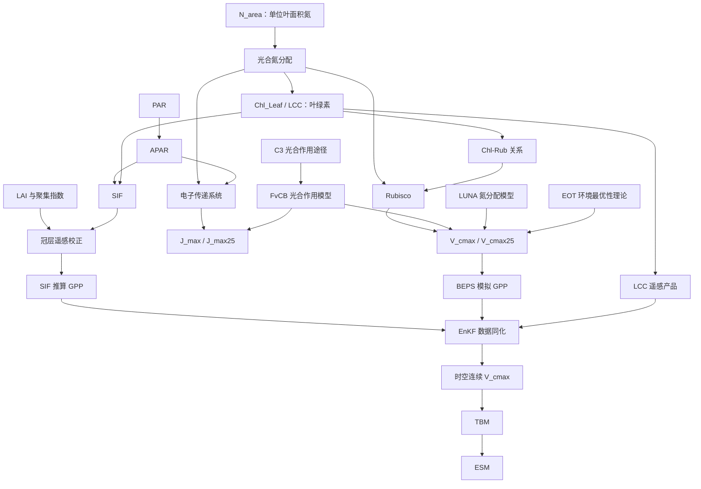

# 26暑期论文名词解释

> 本文按照“基础光合机制 → 叶片资源与生化组分 → 冠层和遥感观测 → 参数反演与模型扩展”的顺序整理。解释依据当前 Vault 中的论文笔记以及 26暑期论文的英文原文。不同论文的具体公式、参数设置、温度响应函数和空间尺度仍应分别核对，不能因为名称相同就直接比较数值。

## 一、先看完整概念链

可以把整组论文压缩成四个问题：

1. **植物的光合能力由什么生理过程决定？**——FvCB、Rubisco、RuBP、$V_{cmax}$ 和 $J_{max}$。
2. **为什么相同叶氮不一定产生相同光合能力？**——氮分配、PNUE、fLNR、叶绿素和叶龄。
3. **怎样从叶片测量扩展到全球连续观测？**——A–$C_i$、LCC、APAR、SIF、LAI 和辐射传输。
4. **怎样把遥感信号转成模型需要的 $V_{cmax}$？**——GPP、BEPS、数据同化、EnKF、LUNA 和 EOT。

---

# 第一层：基础光合机制

## 1. C3 与 C4 光合途径

**C3 植物**和**C4 植物**采用不同的 CO₂ 固定策略。本组论文使用的 FvCB 模型、LUNA 和 Liu-2023 全球反演主要针对 C3 植物或 C3 生物群系。

- **C3 植物**：Rubisco直接参与最初的 CO₂ 羧化，$V_{cmax}$ 和 $J_{max}$ 是描述其光合能力的关键参数。
- **C4 植物**：具有额外的 CO₂ 浓缩机制，不能未经调整就直接套用 C3 模型和参数关系。

**为什么必须先区分**：如果一项产品只覆盖 C3 生物群系，就不能把它自动用于玉米等典型 C4 植物。论文中的 SIF–GPP 关系、最优性参数和 $V_{cmax}$ 反演范围也可能因此受限。

**关联**：C3/C4 → 决定采用哪套光合作用模型 → 决定 $V_{cmax}$、$J_{max}$ 和遥感反演关系是否适用。

主要论文：[[26暑期/Ali-2016_LUNA]]、[[26暑期/Smith-2019_环境优化光合能力]]、[[26暑期/Liu-2023_C3生物群系光合能力]]。

---

## 2. FvCB 模型：整组论文共同的生理框架

**全称**：Farquhar–von Caemmerer–Berry photosynthesis model，也常简称 Farquhar 模型。

**定义**：FvCB 模型用叶片生物化学过程解释 C3 光合作用。在本组论文的简化理解中，光合速率主要受两类能力中的较弱一端限制：

1. **Rubisco 羧化限制**：主要由 $V_{cmax}$ 表示；
2. **RuBP 再生/电子传递限制**：主要由 $J_{max}$ 表示。

因此，$V_{cmax}$ 和 $J_{max}$ 不是两个互不相关的指标，而是 FvCB 模型中两种潜在限制过程的能力参数。

**为什么它贯穿所有论文**：

- 叶片实验用它拟合 A–$C_i$ 曲线；
- LUNA预测其中的 $V_{cmax25}$ 和 $J_{max25}$；
- BEPS把它从叶片扩展到冠层；
- SIF和LCC研究最终仍要把遥感信号转换为这个框架中的光合能力参数。

**一句话理解**：FvCB 是“总框架”，Rubisco、RuBP、$V_{cmax}$ 和 $J_{max}$ 是框架中的关键部件。

主要论文：10篇论文均涉及这一框架，尤其是[[26暑期/Croft-2017_叶绿素与光合能力]]、[[26暑期/Lu-2020_叶绿素与Rubisco]]和[[26暑期/Liu-2023_C3生物群系光合能力]]。

---

## 3. RuBP 与 Calvin–Benson 循环

**RuBP 全称**：ribulose-1,5-bisphosphate，核酮糖-1,5-二磷酸。

**定义**：RuBP 是 Rubisco 进行羧化反应时使用的受体分子。Rubisco把 CO₂ 加到 RuBP 上，碳由此进入后续同化过程。

**RuBP 再生为什么重要**：RuBP在反应中被消耗后需要重新生成。再生过程依赖光反应提供的能量和还原力，因此受到电子传递能力以及 $J_{max}$ 的约束。

可以这样记：

> Rubisco决定“加工 RuBP 和 CO₂ 的能力”，电子传递决定“为 RuBP 再生提供能量的能力”。

当 Rubisco 一端较弱时，光合主要表现为羧化限制；当 RuBP 再生一端较弱时，光合主要表现为电子传递限制。

**关联**：RuBP把“Rubisco–$V_{cmax}$”与“电子传递–$J_{max}$”两条线连接起来。

---

## 4. Rubisco：羧化反应的关键酶

**全称**：ribulose-1,5-bisphosphate carboxylase/oxygenase，核酮糖-1,5-二磷酸羧化酶/加氧酶。

**定义**：Rubisco催化 RuBP 的羧化，是 C3 光合作用固定 CO₂ 的关键酶。因为 Rubisco 蛋白包含大量叶氮，它也是光合氮分配的重要去向。

**Rubisco含量不等于 $V_{cmax}$**：Rubisco含量提供羧化能力的物质基础，但实际 $V_{cmax}$ 还与催化周转率、活化状态、温度和参数拟合方法有关。因此，两片叶子即使 Rubisco 含量相同，也不保证实测 $V_{cmax}$ 完全相同。

**关联**：

- 氮分配 → Rubisco含量；
- Rubisco含量与活性 → $V_{cmax}$；
- 叶绿素与Rubisco的协调关系 → Chl-Rub模型。

主要论文：[[26暑期/Lu-2020_叶绿素与Rubisco]]、[[26暑期/Xu-2012_氮分配机制模型]]。

---

## 5. $V_{cmax}$ 与 $V_{cmax25}$：最大羧化能力

**英文**：maximum carboxylation rate。

**定义**：$V_{cmax}$ 是描述 Rubisco 最大羧化能力的光合参数。在 FvCB 模型中，它控制 Rubisco 限制状态下叶片能够达到的潜在羧化速率。

**它不是实际净光合速率**：$V_{cmax}$ 是能力参数；实际 CO₂ 吸收还受光照、气孔、水分、温度、胞间 CO₂、电子传递和呼吸等因素影响。

### $V_{cmax}$ 与 $V_{cmax25}$ 的区别

- $V_{cmax}$：对应实际叶温或模型温度，随温度即时变化；
- $V_{cmax25}$：把 $V_{cmax}$ 统一换算到 25°C，便于跨地点和时间比较；
- 不同论文可能使用不同温度响应函数，所以同名 $V_{cmax25}$ 仍需核对标准化方法。

### 本组论文中的四种来源

1. A–$C_i$ 气体交换曲线拟合；
2. LCC、叶氮或 Chl-Rub 关系估计；
3. SIF、BEPS 与 EnKF 数据同化反演；
4. LUNA或环境最优性理论预测。

相关概念：[[Vcmax与Vcmax25]]。

---

## 6. $J_{max}$ 与 $J_{max25}$：最大电子传递能力

**英文**：maximum electron transport rate。

**定义**：$J_{max}$ 表示光合电子传递系统的最大能力，关系到光反应提供 ATP、NADPH 以及支持 RuBP 再生的能力。

### 与 $V_{cmax}$ 的区别

- $V_{cmax}$：羧化端能够处理多少 CO₂；
- $J_{max}$：光驱动的电子传递端能够提供多少能量与 RuBP 再生能力。

两端需要协调。如果 Rubisco 投资很高但电子传递不足，增加 Rubisco 不能等比例增加光合；反过来也一样。因此，Xu-2012 和 LUNA 都同时模拟羧化氮和电子传递氮。

**$J_{max25}$**是标准化到25°C的电子传递能力；Ali-2015有时写作 $J_{25}$。

主要论文：[[26暑期/Xu-2012_氮分配机制模型]]、[[26暑期/Ali-2015_全球环境控制]]、[[26暑期/Ali-2016_LUNA]]。

---

## 7. 温度响应函数、热驯化与长期适应

### 温度响应函数（TRF）

温度响应函数描述 $V_{cmax}$ 和 $J_{max}$ 如何随叶温即时变化，也是把观测值标准化到25°C的数学基础。

### 热驯化（acclimation）

热驯化指同一植物个体在一定时间内改变光合装置，使其能力适应生长环境。它不是测量时温度造成的瞬时变化，而是植物生理状态本身发生了调整。

### 长期适应（adaptation）

长期适应涉及种群或物种在更长时间尺度上的差异。Smith-2019把驯化和适应共同作为植物光合能力接近当地环境最优状态的解释。

**为什么要区分**：

- 瞬时温度效应：同一套生化装置在不同温度下反应速度不同；
- 驯化/适应效应：生化装置的数量、配置或最优策略发生变化。

主要论文：[[26暑期/Ali-2015_全球环境控制]]、[[26暑期/Ali-2016_LUNA]]、[[26暑期/Smith-2019_环境优化光合能力]]。

---

## 8. A–$C_i$ 曲线与一点法

**A**：叶片净 CO₂ 同化速率。  
**$C_i$**：叶片胞间 CO₂ 浓度。

**A–$C_i$ 曲线**：在控制光照和温度的条件下，逐步改变叶室 CO₂ 浓度，记录 $A$ 随 $C_i$ 的变化，再用 FvCB 模型拟合 $V_{cmax}$ 和 $J_{max}$。

**为什么它是“地面真值”的主要来源**：全球 $V_{cmax}$ 数据库中的许多记录来自这种气体交换测量，遥感产品和理论模型最终也常用这些数据验证。

**一点法**：只使用一个或少数气体交换状态快速估计 $V_{cmax}$。它提高测量效率，但比完整曲线更依赖假设。

**关联链**：气体交换观测 → A–$C_i$ 曲线 → FvCB拟合 → $V_{cmax}/J_{max}$ → 遥感或模型产品验证。

主要论文：[[26暑期/Croft-2017_叶绿素与光合能力]]、[[26暑期/Lu-2020_叶绿素与Rubisco]]、[[26暑期/Wang-2020_针叶林叶绿素与叶龄]]、[[26暑期/Liu-2023_C3生物群系光合能力]]。

---

# 第二层：叶片氮、叶绿素与代理变量

## 9. $N_{area}$：单位叶面积氮含量

**英文**：area-based leaf nitrogen content，也写作 $N_a$ 或 LNCa。

**定义**：$N_{area}$ 表示单位叶面积上的总叶氮。因为 $V_{cmax}$ 和 $J_{max}$ 也按叶面积表示，$N_{area}$ 经常被用于解释光合能力。

**为什么“氮多”不一定“光合能力强”**：总叶氮包含结构氮、储存氮、呼吸相关氮、光捕获氮、电子传递氮和羧化氮。相同总量若分配方式不同，$V_{cmax}$ 和 $J_{max}$ 就可能不同。

**关联**：

- $N_{area}$ 是资源总量；
- PNUE描述单位资源产生的能力；
- fLNR描述其中分给Rubisco的比例；
- LUNA描述氮在多个功能池之间的最优分配。

相关概念：[[光合氮分配]]。

---

## 10. PNUE、$NUE_{c,25}$ 与 $NUE_{j,25}$：光合氮利用效率

**PNUE**：photosynthetic nitrogen use efficiency，光合氮利用效率。

Ali-2015把光合能力拆成“叶氮总量 × 单位氮产生的能力”来理解：

- **$NUE_{c,25}$**：单位叶氮所支持的 $V_{cmax25}$；
- **$NUE_{j,25}$**：单位叶氮所支持的 $J_{25}$。

**它解决什么问题**：两个地点的 $N_{area}$ 相近，但光照、日长、温度和湿度不同，单位氮的用途和效率可能不同，因此光合能力仍可能相差很大。

**Ali-2015的核心逻辑**：环境因子对光合能力的影响，较大一部分是通过改变氮利用效率体现，而不只是通过改变叶氮总量。

**关联链**：环境 → 氮分配/利用效率 → $V_{cmax25}$、$J_{25}$。

主要论文：[[26暑期/Ali-2015_全球环境控制]]。

---

## 11. fLNR / FLNR：分配给 Rubisco 的叶氮比例

**英文**：fraction of leaf nitrogen in Rubisco。

**定义**：fLNR表示总叶氮中有多大比例被配置到 Rubisco。它比总叶氮更接近羧化过程的氮投入。

在 Lu-2020 的半机制模型中，逻辑是：

$$
\text{总叶氮}\times fLNR \rightarrow \text{Rubisco氮}\rightarrow \text{Rubisco含量}\rightarrow V_{cmax25}
$$

**与 $V_{cmax25}/LCC$ 的联系**：Liu-2023讨论不同生物群系的 $V_{cmax25}/LCC$ 比值，可把它理解为光捕获投资与羧化投资相对关系的综合信号，但不能直接把该比值当成实测 fLNR。

主要论文：[[26暑期/Lu-2020_叶绿素与Rubisco]]、[[26暑期/Liu-2023_C3生物群系光合能力]]。

---

## 12. $Chl_{Leaf}$ 与 LCC：叶片叶绿素含量

**$Chl_{Leaf}$**和**LCC（Leaf Chlorophyll Content）**在本组论文中指向同一底层变量：叶片叶绿素含量。区别主要在表达方式、测量手段和尺度。

### $Chl_{Leaf}$

更常出现在叶片实测研究中，强调单位叶面积上的叶绿素，例如 Croft-2017 和 Wang-2020。

### LCC

既可表示叶片直接测量值，也常表示由卫星反射率和辐射传输模型反演得到的叶绿素产品，例如 Chen-2022 和 Liu-2023。

### 为什么叶绿素能成为光合能力代理

叶绿素负责光捕获；植物对光捕获、电子传递和羧化过程的投资需要协调。因此，叶绿素可能与 Rubisco、$V_{cmax}$ 和 $J_{max}$ 同步变化。

### 不能忽略的边界

- LCC不是Rubisco，也不是 $V_{cmax}$；
- LCC–$V_{cmax}$ 关系会随物种、叶龄、环境和生物群系变化；
- 遥感LCC还受LAI、冠层结构和辐射传输模型影响。

相关概念：[[叶绿素含量（LCC）]]。

---

## 13. Chl-Rub：叶绿素–Rubisco关系

Chl-Rub不是一种物质，而是 chlorophyll–Rubisco relationship 的简写。

其基本形式可理解为：

$$
\text{Rubisco}=a\times\text{Chl}+b
$$

如果特定植被中的斜率和截距相对稳定，就可以沿着以下路径估计光合能力：

> 叶绿素测量/遥感LCC → 估计Rubisco → 结合Rubisco催化周转率 → 估计 $V_{cmax25}$。

**为什么比 Chl–$V_{cmax}$ 直接回归更有机制含义**：它在叶绿素和 $V_{cmax}$ 之间明确加入了负责羧化的 Rubisco。

**局限**：系数会受物种、叶龄、生育阶段、氮分配和Rubisco活化状态影响，不能跨生态系统无条件照搬。

主要论文：[[26暑期/Lu-2020_叶绿素与Rubisco]]、[[26暑期/Croft-2017_叶绿素与光合能力]]。

---

## 14. LMA 与 SLA：叶片结构投入

**LMA**：leaf mass per area，单位叶面积质量。  
**SLA**：specific leaf area，单位叶质量对应的叶面积。

在单位和定义一致时，两者大体呈倒数关系。LMA较高通常表示单位叶面积投入了更多干物质，但不能由此直接推出 $V_{cmax}$ 一定更高。

**为什么在这组论文中出现**：LMA影响按质量和按面积表达的叶氮转换，也用于比较叶片结构投入、氮含量和最优光合能力。

**关联**：LMA/SLA属于叶片结构性状；$N_{area}$、LCC和 $V_{cmax}$ 属于资源、生化或功能性状。阅读时不要混为同一类指标。

---

## 15. 叶龄、MAB 与 DOY

**MAB**：month after budding，萌芽后的月份。  
**DOY**：day of year，一年中的第几天。

它们都是描述叶片发育和季节进程的时间变量。

**为什么叶龄重要**：随着叶片展开、成熟和衰老，叶绿素、Rubisco活性、氮分配、$V_{cmax}$ 和 $J_{max}$ 都可能发生变化。Wang-2020发现叶绿素和MAB共同用于预测针叶林 $V_{cmax25}$，说明仅使用总叶氮会漏掉叶片发育信息。

**关联**：叶龄 → 氮重新分配和叶绿素变化 → $V_{cmax25}/J_{max25}$ 季节变化。

主要论文：[[26暑期/Wang-2020_针叶林叶绿素与叶龄]]、[[26暑期/Lu-2020_叶绿素与Rubisco]]。

---

# 第三层：光环境、冠层与遥感观测

## 16. PAR 与 APAR

**PAR**：Photosynthetically Active Radiation，光合有效辐射。  
**APAR**：Absorbed Photosynthetically Active Radiation，被植被实际吸收的光合有效辐射。

PAR描述可用于光合作用的入射光；APAR进一步考虑其中有多少被叶片或冠层吸收。

**为什么APAR更接近光合过程**：同样的入射PAR，在LAI、叶片角度、聚集状态和叶绿素不同的冠层中，实际吸收量可能不同。

**与SIF的关系**：叶绿素吸收光后，能量主要流向光化学反应、热耗散和荧光发射。SIF的大小因而同时受到APAR和荧光产率影响。

**与 $V_{cmax}$ 的关系**：Liu-2023发现 $V_{cmax}$ 的空间和季节变化与气温和APAR相关，但APAR不是 $V_{cmax}$ 的直接测量值。

相关概念：[[吸收光合有效辐射（APAR）]]。

---

## 17. LAI 与冠层聚集指数 CI

**LAI**：Leaf Area Index，单位地表面积上的叶面积总量。  
**CI**：Clumping Index，冠层聚集指数，描述叶片是否随机分布或形成聚集。

**为什么二者影响遥感**：卫星看到的是冠层整体信号，而不是一片孤立叶片。LAI和CI共同影响：

- 向阳叶和阴叶比例；
- 光在冠层中的吸收与多次散射；
- SIF从冠层逃逸到传感器的概率；
- 从冠层反射率反演叶片LCC的结果。

**常见误区**：LAI较大不等于卫星一定看到更高LCC，也不等于单叶 $V_{cmax}$ 更高。LAI描述叶面积数量，LCC和 $V_{cmax}$ 描述叶片生化或生理状态。

主要论文：[[26暑期/He-2019_SIF反演光合能力]]、[[26暑期/Chen-2022_全球光合能力数据集]]、[[26暑期/Liu-2023_C3生物群系光合能力]]。

---

## 18. SIF：太阳诱导叶绿素荧光

**全称**：Solar-Induced Chlorophyll Fluorescence。

**定义**：叶绿素吸收太阳光后，会将一小部分能量以约650–800 nm荧光重新发射。卫星可以观测这一微弱信号。

**为什么SIF与光合作用相关**：SIF和光化学反应共享叶绿素吸收的光能，因此SIF包含光吸收和光合活动信息。

**为什么SIF不等于GPP或 $V_{cmax}$**：SIF还受APAR、荧光产率、热耗散、冠层结构、观测角度、云和逃逸概率影响。SIF没有与 $V_{cmax}$ 建立简单、普遍适用的一一对应关系。

**三篇论文的方法演进**：

1. He-2019：校正冠层与观测几何，用SIF约束BEPS并更新 $V_{cmax}$；
2. Chen-2022：比较SIF、LCC和SIF+LCC三类全球产品；
3. Liu-2023：让SIF提供动态光合信息，让LCC提供季节预报约束。

相关概念：[[太阳诱导叶绿素荧光（SIF）]]。

---

## 19. $SIF_{total}$ 与逃逸比

卫星观测到的SIF不是冠层发射的全部荧光。部分荧光会被叶片再次吸收或被冠层遮挡，只有一部分能够“逃逸”并到达传感器。

**逃逸比（escape ratio）**：观测到的SIF占冠层总发射SIF的比例。  
**$SIF_{total}$**：经逃逸比校正后估计的冠层总SIF发射。

Liu-2023的处理链是：

> TROPOMI观测SIF → 逃逸比校正 → $SIF_{total}$ → 非线性SIF–GPP关系 → SIF估算GPP。

**意义**：它解释了为什么不能把卫星像元中的原始SIF数值直接与不同冠层、角度或传感器条件下的光合作用进行简单比较。

主要论文：[[26暑期/Liu-2023_C3生物群系光合能力]]。

---

## 20. 辐射传输模型：4-Scale、SAIL 与 PROSPECT

辐射传输模型描述光如何在叶片和冠层中被吸收、反射和透射，是把卫星反射率转换为叶片LCC的重要桥梁。

### 4-Scale

几何光学冠层模型，主要用于森林、灌丛等空间结构较异质、叶片或树冠明显聚集的冠层。

### SAIL

把冠层近似为较均匀的介质，常用于作物和草地等相对均匀冠层。

### PROSPECT

叶片尺度辐射传输模型。论文中先把冠层反射率转换到叶片反射率，再由PROSPECT反演叶绿素含量。

**Liu-2023的LCC链条**：

> MERIS冠层反射率 → 4-Scale/SAIL → 叶片反射率 → PROSPECT → LCC。

**局限**：模型参数、PFT分类、LAI和冠层结构误差都会传递到LCC，再进一步影响 $V_{cmax}$ 反演。

---

## 21. GOME-2、TROPOMI、MERIS 与 MODIS

这些名称是传感器或卫星数据产品，不是光合生理变量。

| 数据源 | 在这组论文中的主要用途 | 需要注意的特点 |
| --- | --- | --- |
| GOME-2 | 提供多年SIF，用于He-2019和Chen-2022的全球 $V_{cmax}$ 产品 | 时间序列较长，但空间分辨率较粗 |
| TROPOMI | 提供较高空间分辨率、近每日覆盖的SIF | Liu-2023用于日尺度0.1°反演 |
| MERIS | 提供多光谱反射率，用于反演LCC | LCC与SIF年份可能不一致 |
| MODIS | 提供LAI、土地覆盖、BRDF和聚集指数等辅助信息 | 影响PFT分类和冠层校正 |

**关联**：传感器提供原始观测 → 辐射传输/几何校正 → LCC或SIF产品 → GPP与 $V_{cmax}$ 反演。

---

# 第四层：碳通量、最优性理论与数据同化

## 22. GPP 与 NPP

**GPP**：Gross Primary Productivity，总初级生产力，表示植被通过光合作用固定的总碳。  
**NPP**：Net Primary Productivity，净初级生产力，通常指GPP扣除植物自身呼吸消耗后形成的净生产。

**为什么GPP是关键中间变量**：SIF与 $V_{cmax}$ 没有直接一一对应关系，但SIF与光合生产力关系更紧密；BEPS也能从 $V_{cmax}$ 模拟GPP。因此，GPP成为连接观测与参数的桥梁：

$$
SIF\rightarrow GPP_{obs}
$$

$$
V_{cmax}\rightarrow BEPS\rightarrow GPP_{model}
$$

数据同化通过比较两类GPP来更新 $V_{cmax}$。

**不要混淆**：$V_{cmax}$是叶片能力参数；GPP是一定空间和时间范围内的碳通量结果。

---

## 23. PFT：植物功能型

**全称**：Plant Functional Type。标准缩写是 **PFT**；原文件最初写作“PTF”属于字母顺序错误。

**定义**：把功能、结构或生活史相近的植物归为一组，使全球模型不必逐一模拟所有物种。常见分类包括常绿针叶林、落叶阔叶林、草地、作物等；具体类别依数据产品或模型而定。

**传统用法**：给每个PFT指定固定的 $V_{cmax25}$、$J_{max25}$ 或其他参数。

**这组论文指出的问题**：同一PFT内部仍存在明显空间、季节和物种差异。把PFT平均值当作永不变化的常数会遗漏环境、叶龄、管理和氮分配信息。

**正确理解**：PFT是必要的分类框架；真正的问题是“分类之后是否仍允许参数动态变化”。

---

## 24. LUNA：最优叶片氮分配模型

**全称**：Leaf Utilization of Nitrogen for Assimilation。

**定义**：LUNA是Ali-2016建立的全球尺度机制模型。它以最优性假设为基础，在光捕获、电子传递、羧化和呼吸等过程之间分配叶氮，并预测 $V_{cmax25}$ 和 $J_{max25}$。

### 输入、过程与输出

- **输入/约束**：叶氮、温度、辐射、湿度、CO₂和日长等；
- **内部过程**：计算氮在不同功能池之间的配置；
- **主要输出**：$V_{cmax25}$、$J_{max25}$及相关光合结果。

### 与 Xu-2012 的联系

Xu-2012先建立了完整氮分配框架；LUNA在此基础上增加更多环境约束、全球观测校准和未来情景模拟。

### 与PFT固定参数的区别

PFT查表法直接给出参数；LUNA允许环境改变最优氮分配，从而改变参数。

**局限**：LUNA模拟的是假设下的最优策略，并不等于直接观测了真实氮分配。

主要论文：[[26暑期/Xu-2012_氮分配机制模型]]、[[26暑期/Ali-2016_LUNA]]。

---

## 25. EOT：生态最优性理论

**全称**：Ecological Optimality Theory。在Chen-2022中，EOT用于生成独立的全球 $V_{cmax}$ 理论产品，与SIF和LCC产品比较。

Smith-2019使用的理论框架包含两个主要部分。

### 光合协调理论（coordination theory）

植物倾向于协调电子传递能力与羧化能力，使平均环境下两类限制不过度失衡。它解释为什么 $J_{max}$ 和 $V_{cmax}$ 会随光照和环境共同调整。

### 最小成本理论（least-cost theory）

植物在维持光合作用时，需要权衡羧化投入和水分运输/气孔开放成本，并倾向于以较低综合成本获得一定碳收益。

### VPD：饱和水汽压差

VPD表示空气的干燥需求，是最小成本理论的重要环境输入。它不同于相对湿度：VPD更直接反映叶片蒸腾和气孔开放所面对的水分压力。

### EOT与遥感方法的区别

- EOT：由光照、温度、VPD、气压和CO₂等环境变量预测最优 $V_{cmax}$；
- SIF/LCC：由卫星观测提供实际空间信息；
- 二者一致处可用于互相验证，差异可能包含灌溉、土壤、叶氮或遥感误差等信息。

主要论文：[[26暑期/Smith-2019_环境优化光合能力]]、[[26暑期/Chen-2022_全球光合能力数据集]]。

---

## 26. BEPS：从叶片光合到冠层GPP

**全称**：Boreal Ecosystem Productivity Simulator。

**定义**：BEPS是过程模型。它使用FvCB叶片光合作用，并通过向阳叶/阴叶的“两叶法”扩展到冠层尺度，模拟GPP和相关碳通量。

### 在反演链中的角色

1. 给BEPS输入候选 $V_{cmax}$、气象、LAI、聚集指数、PFT和土壤等数据；
2. BEPS输出模拟GPP；
3. 将模拟GPP与SIF推算的GPP比较；
4. EnKF根据差异更新 $V_{cmax}$。

**一句话理解**：BEPS是把“待估的叶片能力参数”转换成“可以与SIF观测比较的冠层碳通量”的桥梁。

主要论文：[[26暑期/He-2019_SIF反演光合能力]]、[[26暑期/Liu-2023_C3生物群系光合能力]]。

---

## 27. 数据同化：把模型与观测合并

**英文**：Data Assimilation。

**定义**：数据同化不是把观测直接代入一个经验公式，而是在考虑模型和观测误差的前提下，用新观测不断修正模型状态或参数。

### 五个必须认识的词

- **先验值/背景值（prior/background）**：看到当前观测之前，对 $V_{cmax}$ 的已有估计；
- **时间预报函数（temporal forecast function）**：把前一天的后验值推进到下一天；
- **观测值（observation）**：本组研究中主要是由SIF估算的GPP；
- **后验值（posterior/analysis）**：融合模型和观测后更新的 $V_{cmax}$；
- **误差协方差**：表示参数、模型和观测的不确定性及其共同变化。

### Liu-2023的关键改进

早期方法没有可靠的 $V_{cmax}$ 时间预报函数。Liu-2023利用LCC季节变化建立预报函数，使两次SIF观测之间的 $V_{cmax}$ 不再被默认视为不变。

相关概念：[[EnKF数据同化]]。

---

## 28. EnKF：集合卡尔曼滤波

**全称**：Ensemble Kalman Filter。

**定义**：EnKF用一组可能的参数值表示不确定性，而不是只保存一个 $V_{cmax}$ 数值。每个集合成员进入BEPS产生一套GPP模拟，再依据SIF观测和误差设定共同更新。

### 简化流程

1. 生成多组带扰动的 $V_{cmax}$ 先验集合；
2. 每组参数通过BEPS得到模拟GPP；
3. 将模拟GPP与SIF估算GPP比较；
4. 根据卡尔曼增益调整每个集合成员；
5. 得到后验 $V_{cmax}$，并通过时间预报函数进入下一天。

### 它为什么比简单回归更适合这里

- 可以显式考虑观测误差和模型误差；
- 能让参数随时间更新；
- 可以在SIF缺测时依靠预报函数维持时间连续性。

**局限**：结果仍依赖BEPS结构、先验值、误差设置、集合规模以及SIF–GPP转换关系。

主要论文：[[26暑期/He-2019_SIF反演光合能力]]、[[26暑期/Chen-2022_全球光合能力数据集]]、[[26暑期/Liu-2023_C3生物群系光合能力]]。

---

## 29. TBMs：陆地生物圈模型

**全称**：Terrestrial Biosphere Models，也常译作陆地生态系统模型。

**定义**：TBMs模拟陆地植被和土壤中的光合作用、GPP、呼吸、蒸散、物候及碳库变化。

### $V_{cmax}$为什么重要

许多TBM使用FvCB方案，$V_{cmax}$是控制C3植物羧化能力的关键参数。参数偏差会传递到GPP、碳通量和水分交换。

### 本组论文提供的改进路径

- LUNA：动态氮分配；
- EOT：环境最优性预测；
- LCC/Chl-Rub：生化代理；
- SIF+BEPS+EnKF：遥感动态反演。

**与ESM关系**：TBM可独立运行，也可成为ESM中的陆地生物圈模块。

---

## 30. ESMs：地球系统模型

**全称**：Earth System Models。

**定义**：ESMs耦合大气、海洋、陆地、冰冻圈和碳循环等系统，用于模拟历史气候、未来情景以及气候–碳循环反馈。

### 从叶片参数到地球系统的传递链

$$
V_{cmax},J_{max}
\rightarrow \text{叶片光合作用}
\rightarrow GPP
\rightarrow \text{陆地碳汇}
\rightarrow \text{大气CO}_2
\rightarrow \text{气候反馈}
$$

因此，一个看似微小的叶片参数经过全球网格和多年积分后，可能显著影响ESM结果。

**本组论文的共同问题意识**：只按PFT固定光合能力参数，会遗漏环境适应、氮分配、叶龄以及季节变化。

主要论文：[[26暑期/Ali-2015_全球环境控制]]、[[26暑期/Ali-2016_LUNA]]、[[26暑期/Smith-2019_环境优化光合能力]]。

---

# 第五层：阅读方法和结果时会遇到的辅助名词

## 31. 叶肉导度与“表观 $V_{cmax}$”

**叶肉导度（$g_m$）**描述CO₂从胞间空气到叶绿体羧化位置的传输能力。如果A–$C_i$拟合只使用胞间CO₂而未考虑叶肉内部阻力，估计的 $V_{cmax}$ 可能是“表观值”，不完全等于以叶绿体CO₂为基础的生化能力。

**意义**：不同论文是否考虑 $g_m$，会影响 $V_{cmax}$ 的可比性。Lu-2020明确提醒其拟合未考虑叶肉导度。

---

## 32. SPAD

SPAD是便携式叶绿素仪的相对读数。它能快速、无损地指示叶片叶绿素水平，但不是带有统一物理单位的真实叶绿素含量。

使用时通常需要：

> SPAD读数 → 用实验提取叶绿素进行标定 → 转换为叶绿素含量。

主要论文：[[26暑期/Lu-2020_叶绿素与Rubisco]]。

---

## 33. $R^2$、RMSE 与 rRMSE

**$R^2$**：决定系数，描述模型或关系解释了多少观测变异。高 $R^2$ 不等于误差一定小，也不证明因果关系。

**RMSE**：均方根误差，表示预测值与观测值的典型偏差大小，保留原变量单位。

**rRMSE**：相对RMSE，把RMSE相对于观测均值或其他基准进行标准化，便于跨数据集比较；具体定义必须核对论文。

**阅读原则**：至少同时看 $R^2$ 和RMSE。一个产品可能很好地捕捉空间排序，却存在整体高估或低估。

---

## 34. 三类论文特有的统计与参数估计方法

### 线性混合效应模型

Ali-2015使用。它在估计环境和叶氮关系时，同时处理不同研究、物种或数据来源造成的分组差异。

### 随机森林回归

Wang-2020使用。它用于比较叶绿素、叶龄、叶氮等变量对 $V_{cmax25}$ 的预测重要性。变量重要性表示预测贡献，不自动等于因果作用。

### DREAM(ZS)

Ali-2016使用的贝叶斯/MCMC参数估计算法，用全球观测校准LUNA难以直接测量的参数，并形成后验分布。

---

# 六、建议按这个顺序学习

## 第一遍：只抓主线

1. C3/C4；
2. FvCB；
3. RuBP、Rubisco、$V_{cmax}$、$J_{max}$；
4. $N_{area}$、PNUE、fLNR；
5. $Chl_{Leaf}$/LCC与Chl-Rub；
6. A–$C_i$曲线。

## 第二遍：理解遥感链

1. PAR/APAR；
2. LAI与聚集指数；
3. SIF与 $SIF_{total}$；
4. 4-Scale、SAIL、PROSPECT；
5. GOME-2、TROPOMI、MERIS、MODIS。

## 第三遍：理解反演和模型链

1. GPP/NPP；
2. PFT；
3. BEPS；
4. 数据同化与EnKF；
5. LUNA与EOT；
6. TBM与ESM。

## 最后用五句话记住

1. **FvCB把C3光合作用拆成Rubisco羧化端和电子传递/RuBP再生端，分别由 $V_{cmax}$ 和 $J_{max}$ 表征。**
2. **$N_{area}$是资源总量，PNUE和fLNR说明资源如何被利用或分配；这比“总氮越多，光合越强”更接近机制。**
3. **叶绿素负责吸光，Rubisco负责羧化；LCC和Chl-Rub把可遥感色素信息连接到 $V_{cmax}$。**
4. **SIF提供动态光合信号，BEPS把候选 $V_{cmax}$ 转成GPP，EnKF再用SIF估算GPP更新 $V_{cmax}$。**
5. **LUNA从氮分配预测光合能力，EOT从环境最优性预测光合能力，TBM和ESM则把这些叶片过程扩展到全球碳循环。**
